<p><b>English</b> · <a href="README.md">עברית</a> &nbsp;|&nbsp; ▶️ <a href="https://meir7651231-ui.github.io/buildsmart/flutter/"><b>Try it now on the live site</b></a> · <a href="assets/demo.gif">Animated demo</a></p>

<picture>
  <source media="(prefers-color-scheme: dark)" srcset="assets/hero.svg">
  <source media="(prefers-color-scheme: light)" srcset="assets/hero-light.svg">
  
</picture>

<p align="center">
<a href="https://github.com/meir7651231-ui/buildsmart/actions/workflows/deploy.yml"></a>
<a href="https://github.com/meir7651231-ui/buildsmart/actions/workflows/protocol-enforce.yml"></a>
<a href="https://github.com/meir7651231-ui/buildsmart/actions/workflows/catalog-qa.yml"></a>


</p>

<h3 align="center">One app for site procurement, orders and tasks — with a plumbing catalog that knows what connects to what.</h3>

<p align="center"><a href="#the-problem"><b>The problem</b></a> · <a href="#quick-start">Quick start</a> · <a href="#how-it-works">How it works</a> · <a href="#whats-inside">What's inside</a> · <a href="#when-to-choose-it--and-when-not">When to choose it</a> · <a href="#the-numbers">The numbers</a> · <a href="#run-it-locally">Run it locally</a> · <a href="#status-and-versions">Status</a> · <a href="#faq">FAQ</a> · <a href="#docs">Docs</a></p>

---

## The problem

On a construction site, ordering materials happens over the phone, on WhatsApp and through supplier catalogs full of near-identical items.
One wrong size, or a fitting that doesn't connect to the pipe already laid, and someone drives back to the store while the work waits.

**BuildSmart puts it in one place:** an automatically checked catalog, an engine that works out which fittings connect,
cart and orders, chat, and a separate view for each role — contractor, manager, supplier store, courier and worker.

The app itself is Hebrew-first (right-to-left).

<p align="center">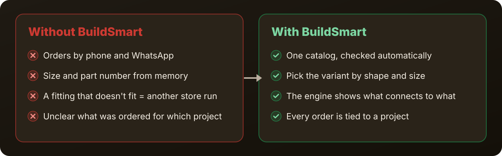</p>

## Quick start

| Path | Time (measured 2026-11-06) | What to do |
|---|---|---|
| **Live site** | 0 — nothing to install | Open the [Flutter preview](https://meir7651231-ui.github.io/buildsmart/flutter/) and tap **"המשך ללא רישום (דוגמה)"** (continue without registering — sample data) |
| **Clean clone: catalog check** | about 4 s (clone 3.7 s + check 0.1 s) | The three commands below. Needs only git and Python 3 |
| **Clean clone: the full app** | about 86 s (pub get 2.4 s + build 80.3 s, warm pub cache) | See [Run it locally](#run-it-locally). Needs Flutter 3.44 |

```bash
git clone --depth 1 https://github.com/meir7651231-ui/buildsmart.git && cd buildsmart
python3 scripts/catalog_qa.py audit      # ✅ zero blocking errors
python3 scripts/catalog_qa.py selftest   # ✅ every rule works
```

<p align="center"></p>

## How it works

<p align="center"></p>

1. **Supplier catalog** — product data (sizes, categories, images) lives in code, in `app_flutter/lib/data/`.
2. **Quality gate** — `scripts/catalog_qa.py` checks the catalog on every data change (the `catalog-qa` workflow). A blocking error turns CI red.
3. **Compatibility engine** — a verified spec graph, connection routing and a bill of materials (BOM) — `app_flutter/lib/logic/install_engine.dart`.
4. **The app** — Flutter, one codebase for iOS, Android and the web. The backend is Firebase (Firestore, Auth, Cloud Functions and security rules); for filtered networks there is an edge proxy (Cloudflare Worker) in `edge-proxy/`.

The full picture, including the key decisions: [`docs/ARCHITECTURE.md`](docs/ARCHITECTURE.md).

## What's inside

<p align="center">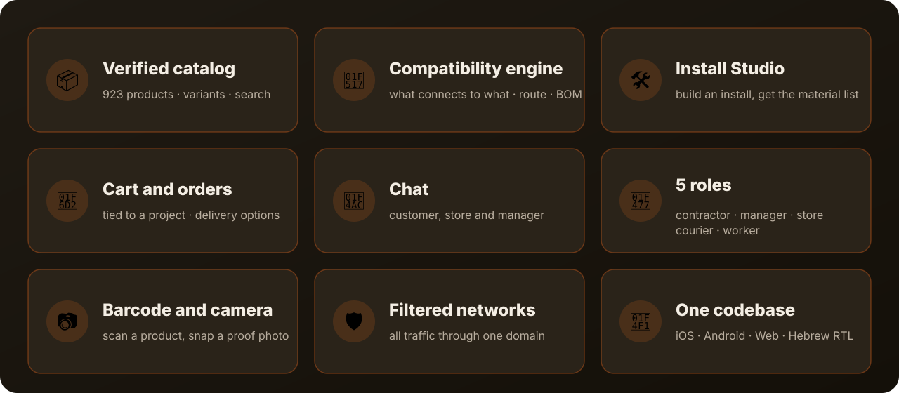</p>

**Screenshots** — real, from `flutter build web` in demo mode (sample data, no login; the UI is in Hebrew). Click for full size; each screen is explained in the [guide](docs/GUIDE.he.md) (Hebrew).

<table>
<tr>
<td align="center"><a href="docs/screenshots/01-welcome.png">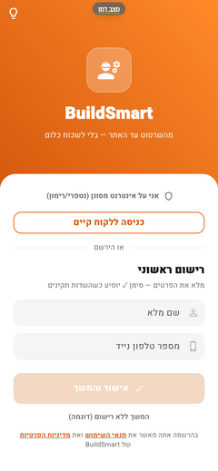</a><br><sub>Welcome</sub></td>
<td align="center"><a href="docs/screenshots/03-home.png">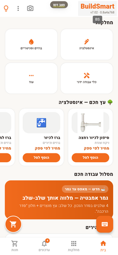</a><br><sub>Home</sub></td>
<td align="center"><a href="docs/screenshots/04-catalog.png">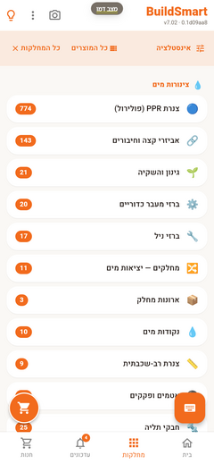</a><br><sub>Catalog</sub></td>
<td align="center"><a href="docs/screenshots/05-variants.png">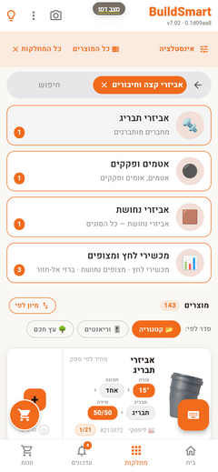</a><br><sub>Variants</sub></td>
<td align="center"><a href="docs/screenshots/06-cart.png">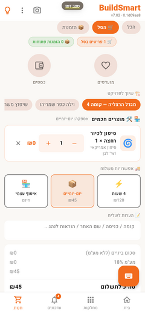</a><br><sub>Cart</sub></td>
</tr>
<tr>
<td align="center"><a href="docs/screenshots/07-notifications.png">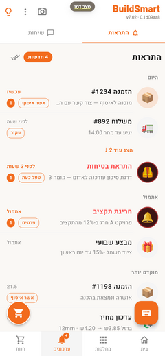</a><br><sub>Notifications</sub></td>
<td align="center"><a href="docs/screenshots/08-chats.png"></a><br><sub>Chat</sub></td>
<td align="center"><a href="docs/screenshots/09-orders-hub.png">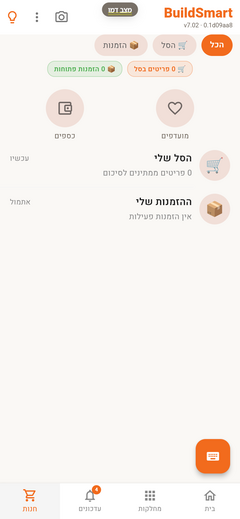</a><br><sub>Procurement</sub></td>
<td align="center"><a href="docs/screenshots/02-roles.png">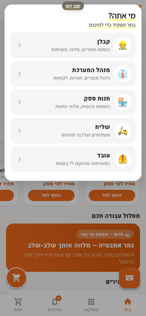</a><br><sub>Roles</sub></td>
<td></td>
</tr>
</table>

**Repo map:**

| Folder / file | What it is | State |
|---|---|---|
| [`app_flutter/`](app_flutter/) | The app — Flutter + Riverpod, iOS · Android · Web, Hebrew RTL | 🟢 active development |
| [`app/`](app/) | The previous version — Preact + TypeScript + Vite (PWA) | 🟡 live on GitHub Pages, bug fixes only |
| [`functions/`](functions/) | Firebase Cloud Functions (TypeScript) — orders, credit, notifications and more | backend |
| [`firestore.rules`](firestore.rules) · [`rules_test/`](rules_test/) | Database security rules and their tests | backend |
| [`edge-proxy/`](edge-proxy/) | Edge proxy (Cloudflare Worker) — all traffic through one domain | backend |
| [`scripts/`](scripts/) | Catalog quality gate, catalog import, build and version scripts | tooling |
| [`docs/`](docs/) | Architecture, guide, screenshots, catalog protocol | docs |
| [`orchestrator/`](orchestrator/) · [`perfect-agent/`](perfect-agent/) · [`tools/atom/`](tools/atom/) · [`atom-engine/`](atom-engine/) | Tooling and procedures for the AI coding agents that build the project | dev tooling |
| [`index.html`](index.html) | The original prototype (~22k lines) — the source of the Hebrew copy | archive / source |

## What it does not do

- **Not in the stores yet.** There is no App Store or Google Play release yet — launch prep is in progress.
- **No card payments.** The app has no payment-gateway integration; the cart computes totals and delivery options.
- **No price list.** Catalog items show "price per supplier".
- **The quality gate covers one catalog.** `catalog_qa.py` checks the Lipskey catalog (`lipskey_catalog.dart`, 923 products) — not the other brand catalogs.
- **Not a substitute for a professional.** The engine suggests connections from catalog specs; the call on site stays with the installer.
- **Some features are off by default.** The no-code Studio is dormant until enabled, and filtered-network mode turns on only when the user picks it.

## When to choose it — and when not

| A good fit if… | Less of a fit if… |
|---|---|
| You work in **plumbing** — the verified catalog is Lipskey and AQUATEC (923 products, 68 categories) | You need a catalog for another trade — today the verified catalog is plumbing |
| Your team **works in Hebrew** — the UI is Hebrew, right-to-left | You need an English or Arabic UI — v1 is Hebrew-only |
| Some users are on a **filtered network** (NetFree, Rimon) — there is a mode that routes traffic through one domain | You need an app in the stores today — the launch is still being prepared |
| You want **orders tied to a project** and a delivery choice (4 hours · 1–2 days · self pickup) | You need in-app card payments — there are none |
| You want **web, Android and iPhone from one codebase** | You need a fixed price list in the catalog — prices are "per supplier" |

## The numbers

<p align="center">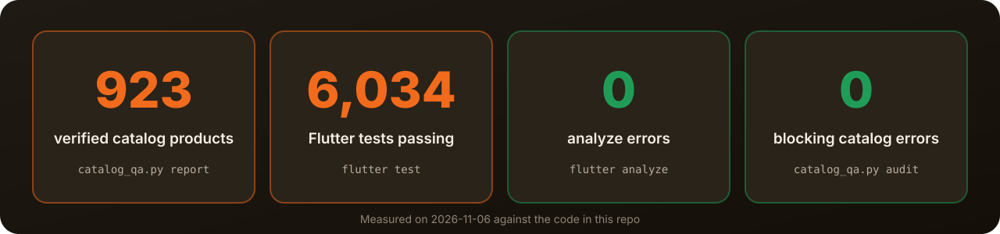</p>

## Run it locally

<p align="center">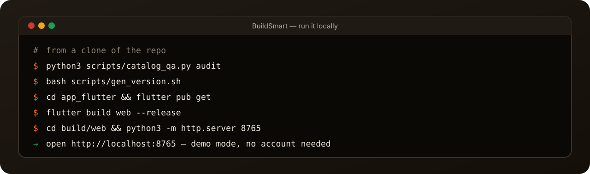</p>

Every command below was run and passed (2026-11-06). You need Python 3, Node 20+ (CI uses 20) and Flutter 3.44 (two workflows still pin 3.29.3).

**Catalog quality gate** (Python only, nothing to install):

```bash
python3 scripts/catalog_qa.py audit       # full check — "zero blocking errors"
python3 scripts/catalog_qa.py selftest    # proves every rule actually fires
python3 scripts/test_catalog_qa.py        # the engine's unit tests — 12/12
python3 scripts/catalog_qa.py truthcheck  # compare against source_truth.json (report)
python3 scripts/catalog_qa.py coverage    # image/size coverage per brand (report)
python3 scripts/catalog_qa.py report      # KPIs: 923 products · 68 categories · 0 errors
```

**The app (Flutter):**

```bash
bash scripts/gen_version.sh               # required before a build — writes lib/version.g.dart
cd app_flutter
flutter pub get
flutter analyze --no-fatal-infos --no-fatal-warnings
flutter test --concurrency=4              # the full suite — 6,034 tests
flutter build web --release               # output in build/web/
cd build/web && python3 -m http.server 8765   # open http://localhost:8765 → demo mode, no account
```

**The previous version (Preact):**

```bash
cd app
npm ci
npm run build
```

## Status and versions

- **App version:** `1.5.2+14` (from `app_flutter/pubspec.yaml`). The build label shown in the app is `v7.02` (from `app_flutter/knowledge/STATUS.md`, via `scripts/gen_version.sh`).
- **Release tags:** none yet. There is a [SemVer proposal](CHANGELOG.md#versioning-proposal-semver--הצעת-גרסאות) in the changelog.
- **Live now:** [GitHub Pages](https://meir7651231-ui.github.io/buildsmart/) (Preact version) and a [Flutter preview](https://meir7651231-ui.github.io/buildsmart/flutter/).
- **CI on `main`:** Deploy to GitHub Pages ✅ · Protocol Enforcement ✅ · Atom Tools ❌ (agent dev tooling, separate from the main CI — [run](https://github.com/meir7651231-ui/buildsmart/actions/runs/32666555496)).
- **In progress:** preparing the store launch. New features are frozen until launch — see [`ROADMAP.md`](ROADMAP.md).

## FAQ

<details><summary><b>Why are there two apps in the repo?</b></summary>

`app/` (Preact) is the version live on the web today. `app_flutter/` is the new one, with a single codebase for iPhone and Android too.
Once the Flutter version is stable it takes over; until then `app/` gets bug fixes only.
</details>

<details><summary><b>What does "what connects to what" mean?</b></summary>

Fittings in the catalog carry a spec (for example diameter and connection type). The engine builds a graph from those specs and works out which items connect,
which connection route is possible, and what to order to complete it.
</details>

<details><summary><b>Can I try it without an account?</b></summary>

Yes. The welcome screen has "continue without registering (sample)" — demo mode with sample data. That is how the screenshots and the demo here were made.
Roles such as the supplier store need an account.
</details>

<details><summary><b>Why an edge proxy?</b></summary>

On filtered networks in Israel (such as NetFree or Rimon) Google services are sometimes blocked. The proxy routes traffic through one project domain. It only runs in "filtered internet" mode.
</details>

<details><summary><b>How do you know the catalog is clean?</b></summary>

`catalog_qa.py audit` runs in CI on every catalog-data change, and `selftest` proves each rule really checks something (a rule that doesn't fire fails).
</details>

<details><summary><b>How can I help?</b></summary>

See [`CONTRIBUTING.md`](CONTRIBUTING.md). Bugs — open an [issue](https://github.com/meir7651231-ui/buildsmart/issues/new/choose). Security problems — only as described in [`SECURITY.md`](SECURITY.md).
</details>

## Docs

| Doc | What's in it |
|---|---|
| [`docs/GUIDE.he.md`](docs/GUIDE.he.md) | User guide — 8 tasks with screenshots (Hebrew) |
| [`docs/ARCHITECTURE.md`](docs/ARCHITECTURE.md) | How the system is built and the key decisions |
| [`docs/CATALOG_PROTOCOL.md`](docs/CATALOG_PROTOCOL.md) · [`scripts/CATALOG_ROADMAP.md`](scripts/CATALOG_ROADMAP.md) | Catalog knowledge protocol and roadmap (Hebrew) |
| [`ROADMAP.md`](ROADMAP.md) | What's now and what's next |
| [`CHANGELOG.md`](CHANGELOG.md) | What changed, by milestone |
| [`CONTRIBUTING.md`](CONTRIBUTING.md) | How to contribute — workflow and checks |
| [`SECURITY.md`](SECURITY.md) | Reporting a security problem |

## Security and license

- **Reporting a security issue:** see [`SECURITY.md`](SECURITY.md). Please don't open a public issue for it.
- **License:** the repo has no license file at the moment.
