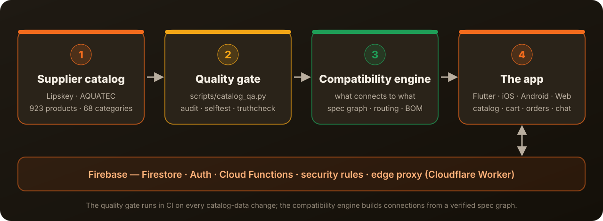

<p align="left"><b>English</b> · <a href="README.md">עברית</a></p>

<p align="center"></p>

<p align="center">
<a href="https://github.com/meir7651231-ui/buildsmart/actions/workflows/deploy.yml"></a>
<a href="https://github.com/meir7651231-ui/buildsmart/actions/workflows/catalog-qa.yml"></a>


</p>

<h3 align="center">One app for site procurement, orders and tasks — with a plumbing catalog that knows what connects to what.</h3>

<p align="center"><a href="#the-problem"><b>The problem</b></a> · <a href="#how-it-works">How it works</a> · <a href="#whats-inside">What's inside</a> · <a href="#run-it-locally">Run it locally</a> · <a href="#status">Status</a> · <a href="#faq">FAQ</a> · <a href="#security-and-license">Security &amp; license</a></p>

---

## The problem

On a construction site, ordering materials happens over the phone, on WhatsApp and through supplier catalogs full of near-identical items.
One wrong size, or a fitting that doesn't connect to the pipe already laid, and someone drives back to the store while the work waits.

**BuildSmart puts it in one place:** an automatically checked catalog, an engine that works out which fittings connect,
cart and orders, chat, and a separate view for each role — contractor, manager, supplier store, courier and worker.

The app itself is Hebrew-first (right-to-left).

## How it works

<p align="center"></p>

1. **Supplier catalog** — product data (sizes, categories, images) lives in code, in `app_flutter/lib/data/`.
2. **Quality gate** — `scripts/catalog_qa.py` checks the catalog on every data change (the `catalog-qa` workflow). A blocking error turns CI red.
3. **Compatibility engine** — a verified spec graph, connection routing and a bill of materials (BOM) — `app_flutter/lib/logic/install_engine.dart`.
4. **The app** — Flutter, one codebase for iOS, Android and the web. The backend is Firebase (Firestore, Auth, Cloud Functions and security rules); for filtered networks there is an edge proxy (Cloudflare Worker) in `edge-proxy/`.

## What's inside

| Folder / file | What it is | State |
|---|---|---|
| [`app_flutter/`](app_flutter/) | The app — Flutter + Riverpod, iOS · Android · Web, Hebrew RTL | 🟢 active development |
| [`app/`](app/) | The previous version — Preact + TypeScript + Vite (PWA) | 🟡 live on GitHub Pages, bug fixes only |
| [`functions/`](functions/) | Firebase Cloud Functions (TypeScript) — orders, credit, notifications and more | backend |
| [`firestore.rules`](firestore.rules) · [`rules_test/`](rules_test/) | Database security rules and their tests | backend |
| [`edge-proxy/`](edge-proxy/) | Edge proxy (Cloudflare Worker) — all traffic through one domain | backend |
| [`scripts/`](scripts/) | Catalog quality gate, catalog import, build and version scripts | tooling |
| [`orchestrator/`](orchestrator/) · [`perfect-agent/`](perfect-agent/) · [`tools/atom/`](tools/atom/) · [`atom-engine/`](atom-engine/) | Tooling and procedures for the AI coding agents that build the project | dev tooling |
| [`index.html`](index.html) | The original prototype (~22k lines) — the source of the Hebrew copy | archive / source |
| [`CATALOG_PROTOCOL.md`](CATALOG_PROTOCOL.md) · [`scripts/CATALOG_ROADMAP.md`](scripts/CATALOG_ROADMAP.md) | Catalog knowledge protocol and roadmap (Hebrew) | docs |

## Run it locally

Every command below was run and passed (2026-11-06). You need Python 3, Node 22 and Flutter 3.44.

**Catalog quality gate** (Python only, nothing to install):

```bash
python3 scripts/catalog_qa.py audit       # full check — "zero blocking errors"
python3 scripts/catalog_qa.py selftest    # proves every rule actually fires
python3 scripts/test_catalog_qa.py        # the engine's unit tests — 12/12
python3 scripts/catalog_qa.py truthcheck  # compare against source_truth.json (report)
python3 scripts/catalog_qa.py coverage    # image/size coverage per brand (report)
python3 scripts/catalog_qa.py report      # KPIs: 923 products · 68 categories · 0 errors
```

**The app (Flutter):**

```bash
bash scripts/gen_version.sh               # required before a build — writes lib/version.g.dart
cd app_flutter
flutter pub get
flutter analyze --no-fatal-infos --no-fatal-warnings
flutter test test/knowledge_protocol_test.dart   # one test file; the full suite runs in CI
flutter build web --release               # output in build/web/
flutter run -d chrome                     # run locally in the browser
```

**The previous version (Preact):**

```bash
cd app
npm ci
npm run build
```

## Status

- **Version:** `1.5.2+14` (from `app_flutter/pubspec.yaml`).
- **Live now:** [GitHub Pages](https://meir7651231-ui.github.io/buildsmart/) (Preact version) and a [Flutter preview](https://meir7651231-ui.github.io/buildsmart/flutter/).
- **CI on `main`:** Deploy to GitHub Pages ✅ · Protocol Enforcement ✅ · Atom Tools ❌ (dev tooling, non-blocking — [run](https://github.com/meir7651231-ui/buildsmart/actions/runs/32666555496)).
- **In progress:** preparing the App Store and Google Play launch. New features are frozen until launch.
- **History:** see [`CHANGELOG.md`](CHANGELOG.md).

## FAQ

<details><summary><b>Why are there two apps in the repo?</b></summary>

`app/` (Preact) is the version live on the web today. `app_flutter/` is the new one, with a single codebase for iPhone and Android too.
Once the Flutter version is stable it takes over; until then `app/` gets bug fixes only.
</details>

<details><summary><b>What does "what connects to what" mean?</b></summary>

Fittings in the catalog carry a spec (for example diameter and connection type). The engine builds a graph from those specs and works out which items connect,
which connection route is possible, and what to order to complete it.
</details>

<details><summary><b>How do you know the catalog is clean?</b></summary>

`catalog_qa.py audit` runs in CI on every catalog-data change, and `selftest` proves each rule really checks something (a rule that doesn't fire fails).
</details>

## Security and license

- **Reporting a security issue:** see [`SECURITY.md`](SECURITY.md). Please don't open a public issue for it.
- **License:** the repo has no license file at the moment.
