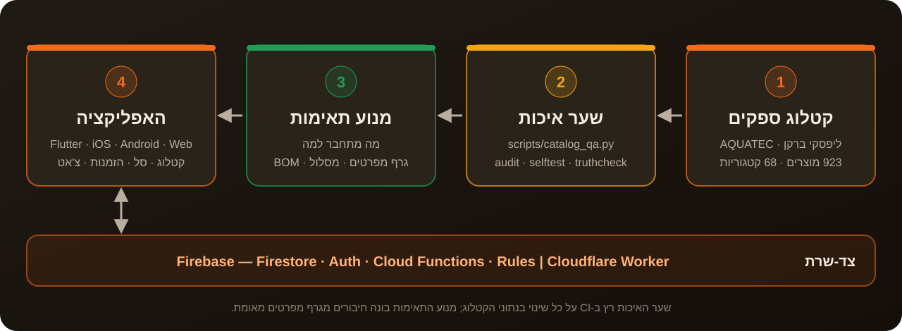

<p align="left"><a href="README.en.md">English</a> · <b>עברית</b></p>

<p align="center"></p>

<p align="center">
<a href="https://github.com/meir7651231-ui/buildsmart/actions/workflows/deploy.yml"></a>
<a href="https://github.com/meir7651231-ui/buildsmart/actions/workflows/catalog-qa.yml"></a>


</p>

<div dir="rtl">

<h3 align="center">אפליקציה אחת לרכש, להזמנות ולמשימות באתר — עם קטלוג אינסטלציה שיודע מה מתחבר למה.</h3>

<p align="center"><a href="#הבעיה"><b>הבעיה</b></a> · <a href="#איך-זה-עובד">איך זה עובד</a> · <a href="#מה-יש-בפנים">מה יש בפנים</a> · <a href="#הרצה-מקומית">הרצה מקומית</a> · <a href="#סטטוס">סטטוס</a> · <a href="#שאלות-נפוצות">שאלות</a> · <a href="#אבטחה-ורישיון">אבטחה ורישיון</a></p>

---

## הבעיה

באתר בנייה, הזמנת חומרים עוברת בטלפון, בוואטסאפ ובקטלוגים של ספקים עם אלפי פריטים כמעט זהים.
מידה לא נכונה או אביזר שלא מתחבר לצנרת שכבר הונחה — ומישהו נוסע שוב לחנות, והעבודה מחכה.

**BuildSmart מרכזת את זה במקום אחד:** קטלוג שנבדק אוטומטית, מנוע שמחשב אילו אביזרים מתחברים זה לזה,
סל והזמנות, שיחות, ומסכים נפרדים לכל תפקיד — קבלן, מנהל, חנות ספק, שליח ועובד.

## איך זה עובד

<p align="center"></p>

1. **קטלוג ספקים** — נתוני המוצרים (מידות, קטגוריות, תמונות) יושבים בקוד, ב-`app_flutter/lib/data/`.
2. **שער איכות** — `scripts/catalog_qa.py` בודק את הקטלוג בכל שינוי בנתונים (workflow‏ `catalog-qa`). שגיאה חוסמת = ה-CI אדום.
3. **מנוע תאימות** — גרף מפרטים מאומת, חישוב מסלול חיבור ורשימת חומרים (BOM) — `app_flutter/lib/logic/install_engine.dart`.
4. **האפליקציה** — Flutter, קוד אחד ל-iOS, ל-Android ולווב. צד-השרת הוא Firebase (Firestore, Auth, Cloud Functions וחוקי אבטחה), ולרשתות מסוננות יש מתווך-קצה (Cloudflare Worker) ב-`edge-proxy/`.

## מה יש בפנים

| תיקייה / קובץ | מה זה | מצב |
|---|---|---|
| [`app_flutter/`](app_flutter/) | האפליקציה — Flutter + Riverpod, ‏iOS · Android · Web, עברית מימין לשמאל | 🟢 פיתוח פעיל |
| [`app/`](app/) | הגרסה הקודמת — Preact + TypeScript + Vite (PWA) | 🟡 חיה ב-GitHub Pages, תיקוני באגים בלבד |
| [`functions/`](functions/) | Firebase Cloud Functions ‏(TypeScript) — הזמנות, אשראי, התראות ועוד | צד-שרת |
| [`firestore.rules`](firestore.rules) · [`rules_test/`](rules_test/) | חוקי האבטחה של מסד הנתונים + בדיקות שלהם | צד-שרת |
| [`edge-proxy/`](edge-proxy/) | מתווך-קצה (Cloudflare Worker) — כל התעבורה דרך דומיין אחד | צד-שרת |
| [`scripts/`](scripts/) | שער האיכות של הקטלוג, ייבוא קטלוג, סקריפטי build וגרסה | כלים |
| [`orchestrator/`](orchestrator/) · [`perfect-agent/`](perfect-agent/) · [`tools/atom/`](tools/atom/) · [`atom-engine/`](atom-engine/) | הכלים והנהלים של סוכני הפיתוח שבונים את הפרויקט | כלי פיתוח |
| [`index.html`](index.html) | אב-הטיפוס המקורי (כ-22 אלף שורות) — מקור הטקסטים בעברית | ארכיון / מקור |
| [`CATALOG_PROTOCOL.md`](CATALOG_PROTOCOL.md) · [`scripts/CATALOG_ROADMAP.md`](scripts/CATALOG_ROADMAP.md) | פרוטוקול הידע של הקטלוג ומפת הדרכים שלו | מסמכים |

## הרצה מקומית

כל הפקודות כאן הורצו ועברו (6.11.2026). צריך Python 3, ‏Node 22 ו-Flutter 3.44.

**שער האיכות של הקטלוג** (Python בלבד, בלי התקנות):

<div dir="ltr">

```bash
python3 scripts/catalog_qa.py audit       # בדיקה מלאה — "אפס שגיאות חוסמות"
python3 scripts/catalog_qa.py selftest    # מוכיח שכל חוק באמת יורה
python3 scripts/test_catalog_qa.py        # בדיקות היחידה של המנוע — 12/12
python3 scripts/catalog_qa.py truthcheck  # השוואה מול source_truth.json (דוח)
python3 scripts/catalog_qa.py coverage    # כיסוי תמונה/מידה לפי מותג (דוח)
python3 scripts/catalog_qa.py report      # מדדי איכות: 923 מוצרים · 68 קטגוריות · 0 שגיאות
```

</div>

**האפליקציה (Flutter):**

<div dir="ltr">

```bash
bash scripts/gen_version.sh               # חובה לפני build — מייצר את lib/version.g.dart
cd app_flutter
flutter pub get
flutter analyze --no-fatal-infos --no-fatal-warnings
flutter test test/knowledge_protocol_test.dart   # קובץ בדיקה אחד; הסוויטה המלאה רצה ב-CI
flutter build web --release               # התוצר ב-build/web/
flutter run -d chrome                     # הרצה מקומית בדפדפן
```

</div>

**הגרסה הקודמת (Preact):**

<div dir="ltr">

```bash
cd app
npm ci
npm run build
```

</div>

## סטטוס

- **גרסה:** ‏`1.5.2+14` (לפי `app_flutter/pubspec.yaml`).
- **חי עכשיו:** [GitHub Pages](https://meir7651231-ui.github.io/buildsmart/) (גרסת Preact) ו-[תצוגה מקדימה של Flutter](https://meir7651231-ui.github.io/buildsmart/flutter/).
- **CI על `main`:** ‏Deploy to GitHub Pages ✅ · Protocol Enforcement ✅ · Atom Tools ❌ (כלי פיתוח, לא חוסם — [ריצה](https://github.com/meir7651231-ui/buildsmart/actions/runs/32666555496)).
- **בעבודה:** הכנה להשקה בחנויות (App Store ו-Google Play). פיצ'רים חדשים מוקפאים עד ההשקה.
- **היסטוריה:** ראו [`CHANGELOG.md`](CHANGELOG.md).

## שאלות נפוצות

<details><summary><b>למה יש שתי אפליקציות בריפו?</b></summary>

`app/` (Preact) היא הגרסה שחיה היום בווב. `app_flutter/` היא הגרסה החדשה, עם קוד אחד גם לאייפון ולאנדרואיד.
כשגרסת Flutter תתייצב — עוברים אליה, ו-`app/` נשארת לתיקוני באגים בלבד עד אז.
</details>

<details><summary><b>מה זה "מה מתחבר למה"?</b></summary>

לאביזרים בקטלוג יש מפרט (למשל קוטר וסוג חיבור). המנוע בונה מהם גרף ומחשב אילו פריטים מתחברים,
איזה מסלול חיבור אפשרי, ומה צריך להזמין כדי לסגור אותו.
</details>

<details><summary><b>איך יודעים שהקטלוג נקי?</b></summary>

`catalog_qa.py audit` רץ ב-CI על כל שינוי בנתוני הקטלוג, ו-`selftest` מוכיח שכל חוק בודק באמת (חוק שלא יורה — נכשל).
</details>

## אבטחה ורישיון

- **דיווח על בעיית אבטחה:** ראו [`SECURITY.md`](SECURITY.md). בבקשה לא לפתוח על זה issue ציבורי.
- **רישיון:** לריפו אין כרגע קובץ רישיון.

</div>
