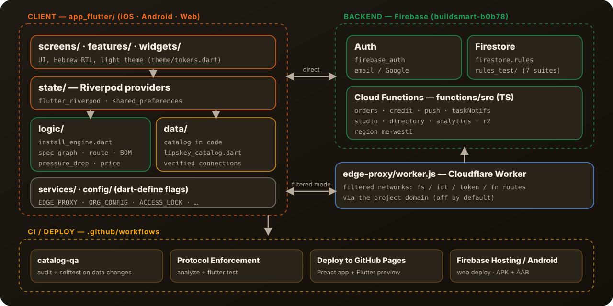

# Architecture

<b>בעברית בקצרה:</b> אפליקציית Flutter אחת (iOS · Android · Web) שמחזיקה את הקטלוג בקוד. שער איכות (<code>scripts/catalog_qa.py</code>) בודק את הקטלוג ב-CI, ומנוע תאימות (<code>logic/install_engine.dart</code>) מחשב מה מתחבר למה. צד-השרת הוא Firebase (Auth, Firestore, Cloud Functions), ולרשתות מסוננות יש מתווך-קצה ב-Cloudflare. ההחלטות המרכזיות מפורטות בסוף המסמך.

## The pieces

| Part | Where | What it does |
|---|---|---|
| UI | `app_flutter/lib/screens/`, `features/`, `widgets/`, `theme/` | Hebrew RTL screens, light theme, brand orange `#F26B1D` (`theme/tokens.dart`) |
| State | `app_flutter/lib/state/` | Riverpod providers (`flutter_riverpod`); settings persisted with `shared_preferences` |
| Catalog data | `app_flutter/lib/data/` | Products, categories, the catalog tree and verified connections live **in code** (e.g. `lipskey_catalog.dart`, `lipskey_verified_connections.dart`) |
| Compatibility engine | `app_flutter/lib/logic/install_engine.dart` | Builds a graph from fitting specs (diameter `dn`, connection method), finds a connection route and a bill of materials |
| Services and flags | `app_flutter/lib/services/`, `config/` | Backend access; features switched with `--dart-define` flags such as `EDGE_PROXY`, `ORG_CONFIG`, `ACCESS_LOCK` |
| Backend | `firebase.json`, `firestore.rules`, `functions/` | Firebase project `buildsmart-b0b78`: Auth (phone, email, Google), Firestore with security rules, Cloud Functions in TypeScript |
| Rules tests | `rules_test/` | 7 test suites for `firestore.rules` |
| Edge proxy | `edge-proxy/worker.js` | Cloudflare Worker that forwards Firestore / Identity / token / Functions calls through the project domain, for filtered networks |
| Previous app | `app/` | Preact + TypeScript + Vite PWA, live on GitHub Pages, bug fixes only |

## The flow: catalog → quality gate → engine → app

1. **Catalog in code.** Supplier data is converted into Dart files under `app_flutter/lib/data/` (import tooling in `scripts/`). Products carry a SKU and a category, and a size and image where known. The full data model is in [`CATALOG_PROTOCOL.md`](CATALOG_PROTOCOL.md) (Hebrew).
2. **Quality gate.** `scripts/catalog_qa.py` parses `lipskey_catalog.dart` and enforces the rules:
   - `audit` — zero blocking errors, or CI fails (`catalog-qa` workflow, on every change to `app_flutter/lib/data/**`).
   - `selftest` — plants a bad record for each tested rule (7 of the 8 blocking rules, plus two non-blocking ones) and checks that it fires, and that a clean record fires nothing — so a rule that silently stops working fails.
   - `truthcheck` / `coverage` / `report` — comparison with `source_truth.json`, image and size coverage per brand, KPIs.
3. **Compatibility engine.** At runtime the engine reads the specs from the catalog, works out which fittings connect, a possible route between two ends, and what to order (BOM).
4. **App.** The screens show the catalog, variant chips (shape, size, thread), the cart (tied to a project, with delivery options), orders, chat and notifications. Data that is shared between users (orders, chats, users) lives in Firestore; server-side steps (order stages, credit, push, e-mail) run in Cloud Functions.

## CI and deploy

| Workflow | Runs on | Does |
|---|---|---|
| `catalog-qa` | push / PR touching catalog data | `selftest` + `audit` |
| `Protocol Enforcement` | `main`, the dev branch, PRs to `main` | `flutter analyze` + `flutter test` (6,034 tests) |
| `Deploy to GitHub Pages` | `main`, the dev branch | builds `app/` and the Flutter web preview, pushes to `gh-pages` |
| Firebase Hosting / Android workflows | the dev branch, manual | Flutter web to Firebase Hosting; APK + AAB builds |

## Key decisions

| Decision | Why (from the repo's own docs) |
|---|---|
| **Flutter for the new app**, Preact kept live | One codebase for iOS, Android and the web (`app_flutter/README.md`). The Preact app stays the live reference until cutover (`CLAUDE.md`). |
| **Riverpod for state** | Closest in spirit to `@preact/signals` used by the Preact app (`app_flutter/pubspec.yaml` comment). |
| **Catalog in code, guarded by a gate** | Clean-looking data is not proof of correct data; only comparison with the source proves it, and every change goes through the audit (`CATALOG_PROTOCOL.md` §1). |
| **Hebrew copy taken verbatim from the prototype** | Labels come from the legacy `index.html`, never invented (rule R6 in `app_flutter/README.md`). |
| **Risky features ship dormant** | Studio, the edge proxy and other capabilities are behind flags and off by default (merged PRs #6, #28, #32). |
| **Edge proxy for filtered networks** | Users on filtered networks may have Google hosts blocked; the proxy keeps all traffic on one approved domain (`edge-proxy/README.md`). |
| **Secrets only on the server** | Storage credentials live in Cloud Functions, never in the client (`functions/src/r2.ts`). |
