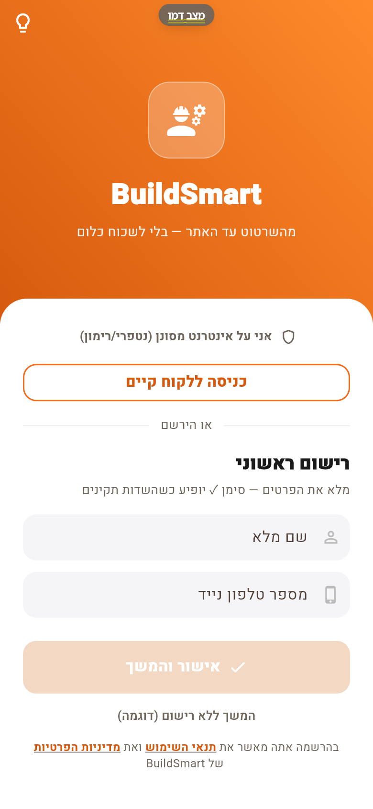
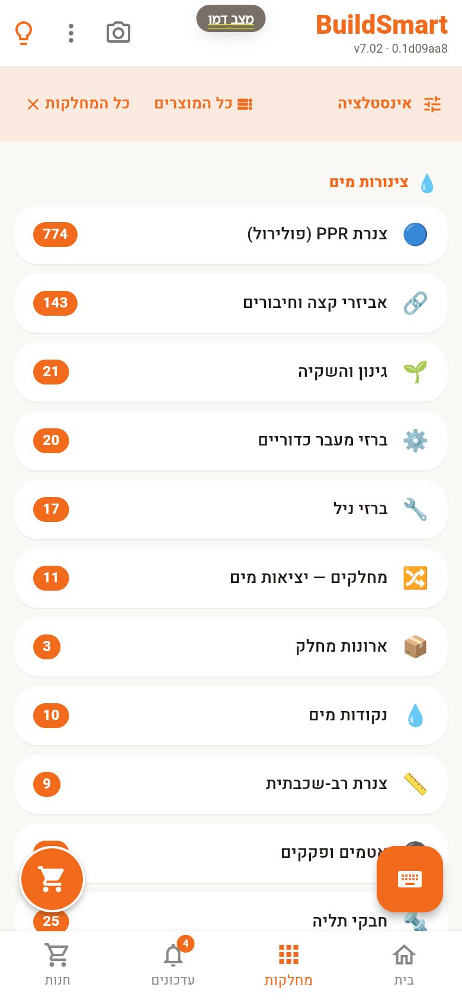
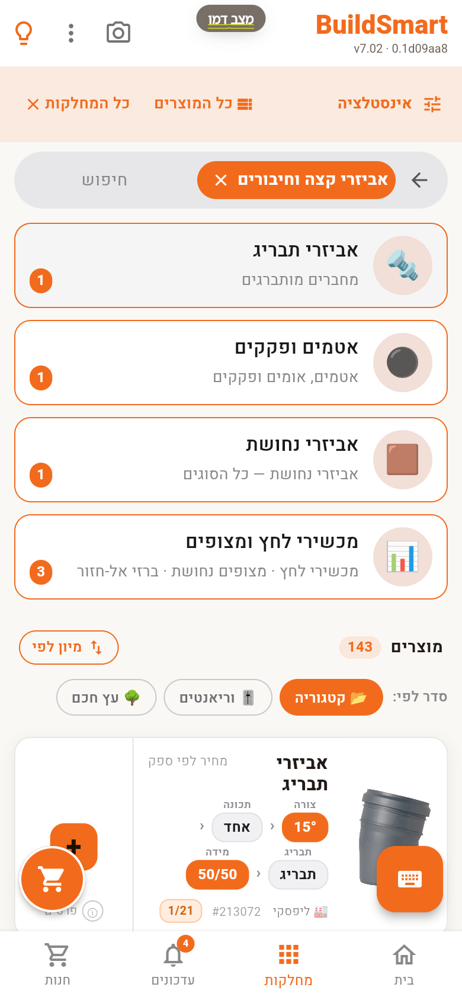
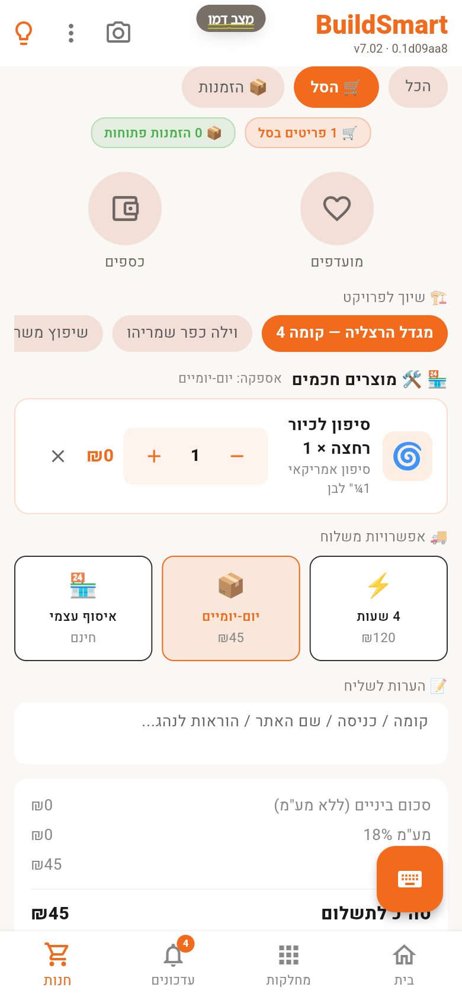
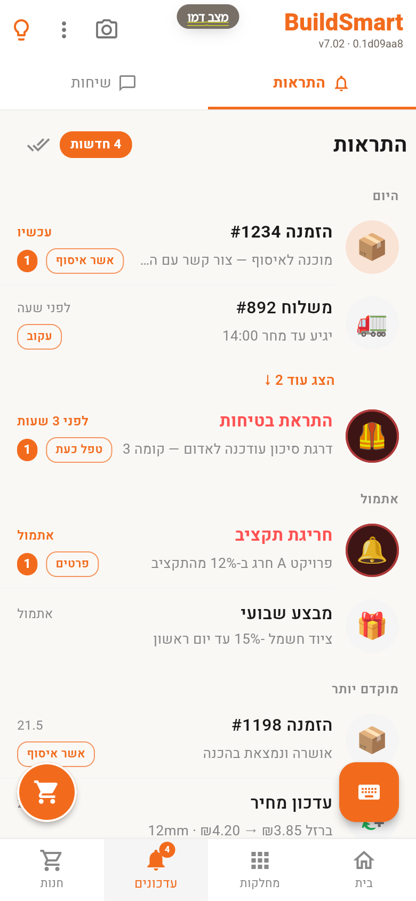
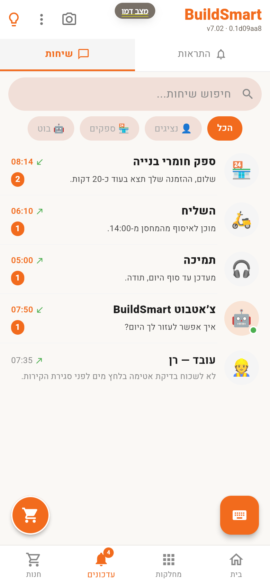
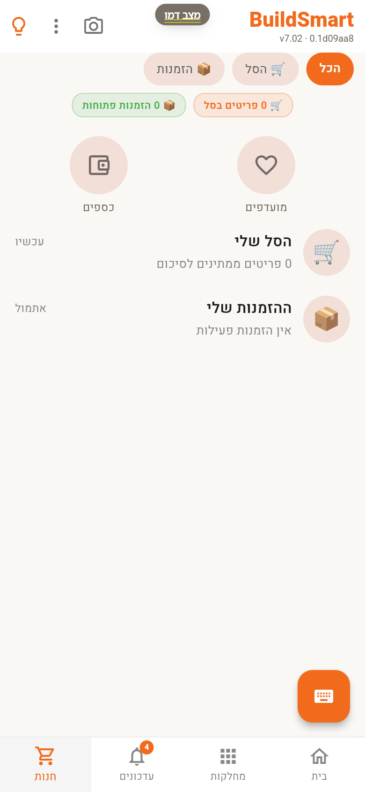
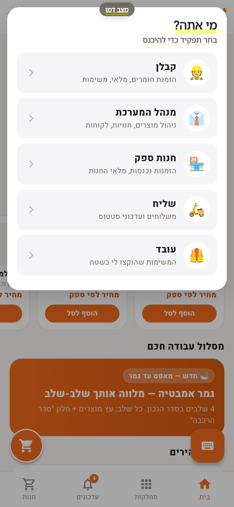

# מדריך שימוש — 8 משימות

המדריך מראה איך עושים את הדברים הנפוצים באפליקציה. כל הצילומים צולמו במצב דמו (נתוני דוגמה, בלי חשבון).
אפשר לעקוב בזמן אמת באתר החי: **[התצוגה המקדימה של Flutter](https://meir7651231-ui.github.io/buildsmart/flutter/)**.

| # | משימה | למי |
|---|---|---|
| 1 | [להיכנס במצב דמו](#1-להיכנס-במצב-דמו) | כולם |
| 2 | [למצוא מוצר לפי מחלקה](#2-למצוא-מוצר-לפי-מחלקה) | קבלן |
| 3 | [לבחור את הווריאנט הנכון](#3-לבחור-את-הווריאנט-הנכון) | קבלן |
| 4 | [להוסיף לסל, לשייך לפרויקט ולבחור משלוח](#4-להוסיף-לסל-לשייך-לפרויקט-ולבחור-משלוח) | קבלן |
| 5 | [לעקוב אחרי הזמנות ומשלוחים](#5-לעקוב-אחרי-הזמנות-ומשלוחים) | קבלן · מנהל |
| 6 | [לדבר עם הספק, השליח והצוות](#6-לדבר-עם-הספק-השליח-והצוות) | קבלן · חנות |
| 7 | [לראות את הסל וההזמנות במקום אחד](#7-לראות-את-הסל-וההזמנות-במקום-אחד) | קבלן |
| 8 | [לעבור לתפקיד אחר](#8-לעבור-לתפקיד-אחר) | מנהל · חנות · שליח · עובד |

---

## 1. להיכנס במצב דמו

1. פותחים את האפליקציה.
2. לוחצים **"המשך ללא רישום (דוגמה)"** בתחתית המסך.
3. בוחרים תחום (**אינסטלטור**) ומדלגים על מסכי ההיכרות.

מי שעובד ברשת מסוננת (נטפרי, רימון) מסמן קודם **"אני על אינטרנט מסונן"** — כך התעבורה עוברת דרך דומיין אחד.

 

## 2. למצוא מוצר לפי מחלקה

1. במסך הבית לוחצים על **אינסטלציה** (או על הלשונית **מחלקות** למטה).
2. בוחרים קטגוריה — ליד כל אחת מופיע מספר המוצרים שבה.
3. אפשר גם לחפש בשורת החיפוש שבראש הרשימה.

 

## 3. לבחור את הווריאנט הנכון

1. בכרטיס המוצר יש **שבבי בחירה**: צורה (למשל 15°), מידה (למשל 50/50) וסוג חיבור.
2. בוחרים את השילוב המתאים — הכרטיס מתעדכן לפי הבחירה.
3. אפשר למיין (**מיון לפי**) ולסדר לפי **קטגוריה**, **וריאנטים** או **עץ חכם**.

 

## 4. להוסיף לסל, לשייך לפרויקט ולבחור משלוח

1. מוסיפים מוצר בכפתור **הוסף לסל** (למשל בכרטיסי "עץ חכם" שבמסך הבית), ואז לוחצים על כפתור הסל העגול (משמאל למטה).
2. תחת **"שיוך לפרויקט"** בוחרים את הפרויקט (למשל "מגדל הרצליה — קומה 4").
3. בוחרים משלוח: **4 שעות**, **יום-יומיים** או **איסוף עצמי**.
4. מוסיפים הערות לשליח (קומה, כניסה, שם האתר).

 

## 5. לעקוב אחרי הזמנות ומשלוחים

1. לוחצים על הלשונית **עדכונים** למטה.
2. בלשונית **התראות** רואים הזמנות, משלוחים, התראות בטיחות וחריגות תקציב — לפי זמן.
3. לכל התראה יש פעולה: **אשר איסוף**, **עקוב**, **טפל כעת**.

 

## 6. לדבר עם הספק, השליח והצוות

1. בלשונית **עדכונים** עוברים ל-**שיחות**.
2. מסננים לפי **נציגים**, **ספקים** או **בוט**, או מחפשים בשורת החיפוש.
3. כל שיחה מראה את ההודעה האחרונה ומספר הודעות שלא נקראו.

 

## 7. לראות את הסל וההזמנות במקום אחד

1. לוחצים על הלשונית **חנות** למטה.
2. רואים את **הסל שלי** ואת **ההזמנות שלי**, וגם **מועדפים** ו**כספים**.
3. השבבים למעלה (**הכל · הסל · הזמנות**) מסננים את התצוגה.

 

## 8. לעבור לתפקיד אחר

1. לוחצים על הכיתוב **BuildSmart** בראש המסך.
2. בוחרים תפקיד: **קבלן**, **מנהל המערכת**, **חנות ספק**, **שליח** או **עובד**.
3. במצב דמו, בחירה ב**חנות ספק** מחזירה למסך הכניסה — צריך חשבון. בחירה ב**קבלן** משאירה את מסך הבית (מסכי הקבלן הייעודיים עדיין בבנייה).

 

---

רוצים להריץ מקומית? ראו [הרצה מקומית](../README.md#הרצה-מקומית). איך זה בנוי? ראו [ARCHITECTURE.md](ARCHITECTURE.md).

